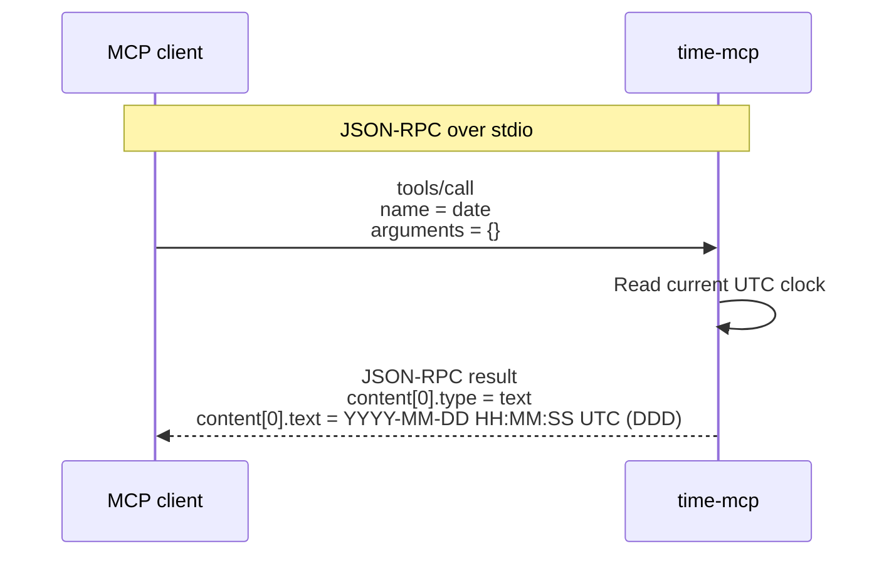

<div align="center">

<h1>time-mcp</h1>

<p><strong>A tiny UTC clock for MCP.</strong><br />Written in assembly. Launched over <code>stdio</code>.</p>

<p><strong>697 bytes</strong> &nbsp;·&nbsp; Current Linux x86 ELF32 build</p>

<p><em>Smaller is the goal.</em></p>

</div>

Tiny binaries, real utility: `time-mcp` is a [Model Context Protocol (MCP)](https://modelcontextprotocol.io) server that returns the current UTC timestamp. The client launches it directly over `stdio`.

## One call, one timestamp



The server handles MCP initialization and tool discovery, then exposes one no-argument tool, `date`. Call it with `{}`. It returns text in this format:

```text
YYYY-MM-DD HH:MM:SS UTC (DDD)
```

## Get running

Build the native target for your machine:

```sh
make
```

Connect it from MCP Inspector or MCPJam Inspector using **STDIO**, the absolute path to the executable, and no arguments. Then list tools and run `date` with `{}`.

| Setting | Value |
| :--- | :--- |
| Transport | `STDIO` |
| Command | Absolute path, such as `/path/to/time-mcp/time-mcp` |
| Arguments | None |

On macOS Apple Silicon, `make` also builds Linux ELF32 when NASM is installed. On Linux x86/x86_64, it builds the Linux target. Linux requires a kernel with 32-bit x86 support; native macOS Intel and Linux ARM builds are not provided.

## Test it

The C regression harness exercises the assembly server over `stdio`. Install the test-only compiler, `pkg-config`, and `json-c` dependencies described in [CONTRIBUTING.md](CONTRIBUTING.md), then run the test for your platform:

```sh
make test-macos
# or, on Linux x86/x86_64
make test-linux
```

## Under the hood

| Target | Implementation |
| :--- | :--- |
| **Linux** | Hand-crafted x86 ELF32 executable with an overlapped header; no libraries or dynamic linker; four kernel syscalls: `sys_read`, `sys_time`, `sys_write`, `sys_exit`. |
| **macOS** | Native Apple Silicon arm64 assembly using XNU syscalls and Apple's standard linker. |

These are separate native executables, not a universal binary. File lengths are measured with `wc -c` and can be reproduced with `make size`. The macOS file includes Mach-O alignment and an ad-hoc code signature, so its total size is not a measure of the assembly code alone. The production executables have no library dependencies.
